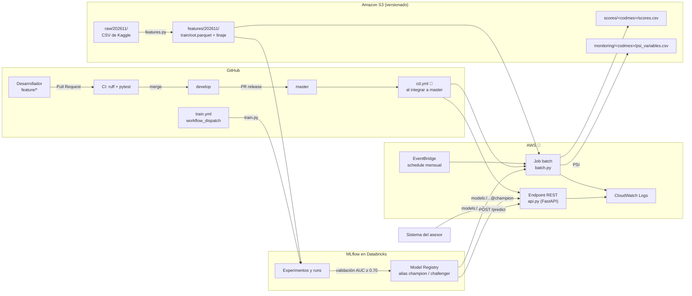

# UTEC Bank – Predicción de fuga de clientes (MLOps)

Trabajo integrador del curso **MLOps – UTEC Posgrado 2026-2**, Grupo 3.

Solución MLOps de punta a punta que predice qué clientes del segmento personas de UTEC Bank tienen
mayor probabilidad de **fugar en los próximos 6 meses**: desde los datos crudos versionados en S3
hasta el modelo registrado en MLflow, servido en batch y online y monitoreado con PSI.

> **Estado:** las secciones marcadas con 🚧 están en implementación (despliegue en AWS y workflows de
> entrenamiento/CD). Se actualizarán cuando se integren a `develop`.

---

## 1. Problema de negocio

La tasa de fuga (*attrition*) del segmento personas subió de forma significativa en el último año y
afecta la rentabilidad. El modelo se consume de dos formas:

| Modo | Usuario | Uso |
|---|---|---|
| **Batch mensual** | Área de retención | A inicios de mes recibe en S3 la lista de clientes ordenada por probabilidad de fuga para priorizar campañas. |
| **Online (tiempo real)** | Asesor del contact center | Cuando un cliente llama o pide cerrar un producto, consulta su probabilidad de fuga para decidir si ofrecerle una propuesta de retención. |

**Criterio de éxito técnico:** AUC en test ≥ **0.70** (`mlflow.min_auc_test`), con métricas de
priorización (% de fugas capturadas en el top 10 % y 20 %).

---

## 2. Arquitectura

Detalle completo en [`docs/arquitectura.md`](docs/arquitectura.md).



---

## 3. Componentes del pipeline

| Paso | Módulo | Qué hace |
|---|---|---|
| Ingesta y versionado | `src/bank_attrition/data.py` | Sube los CSV crudos a `s3://<bucket>/raw/<yyyymm>/` validando SHA-256 y filas contra `docs/manifiesto_datos.json`. |
| Features | `src/bank_attrition/features.py` | Cruza clientes + requerimientos (ventana de 5 meses), crea conteos por tipo, dictamen, top-5 producto/submotivo y variables de rezago. Guarda `train/oot.parquet` y su linaje en S3. |
| Preprocesamiento | `src/bank_attrition/preprocess.py` | `ColumnTransformer` de scikit-learn: mediana para numéricas y `"MISSING"` + one-hot para categóricas. Se ajusta solo con train y **viaja dentro del modelo**. |
| Entrenamiento | `src/bank_attrition/train.py` | Split 70/30 estratificado, entrena **Regresión Logística, Random Forest y LightGBM** en runs anidados, elige el mejor por `test_auc`, lo registra y lo promueve a `champion`/`challenger`. |
| Evaluación | `src/bank_attrition/evaluate.py` | AUC, Gini, KS, % de fugas capturadas en top 10 %/20 %; curva ROC, matriz de confusión e importancia de variables. |
| Inferencia batch | `src/bank_attrition/batch.py` | Carga `@champion` desde el Registry, scorea el OOT y escribe `id_cliente, prob_fuga, decil, segmento_riesgo, codmes_score, fecha_score, model_version`. |
| Monitoreo | `src/bank_attrition/monitoring.py` | PSI por variable y sobre el score (train vs aplicación) con semáforo: < 0.10 estable · 0.10–0.25 alerta · > 0.25 crítico. |
| Inferencia online | `src/bank_attrition/api.py` | API FastAPI con `/health` y `/predict`; valida la entrada y responde la probabilidad y la versión del modelo. |

Todos los parámetros (rutas, semillas, hiperparámetros, umbrales) están en
[`config/config.yaml`](config/config.yaml).

---

## 4. Requisitos y configuración

- Python **3.11 – 3.13** (el CI usa 3.12)
- Cuenta de AWS con un bucket S3 con versionado activado
- Workspace de Databricks con MLflow (tracking server y Model Registry en Unity Catalog)

```bash
# 1. Clonar e instalar
git clone https://github.com/utec-curso-mlops-2026-2/mlops-bank-attrition-grupo3.git
cd mlops-bank-attrition-grupo3
python -m venv .venv
# Linux/Mac: source .venv/bin/activate   |   Windows: .venv\Scripts\activate
pip install -e ".[dev]"

# 2. Variables de entorno
cp .env.example .env     # completar los valores; .env nunca se versiona
```

Variables principales de `.env` (en GitHub Actions van como **Secrets/Variables**):

| Variable | Descripción |
|---|---|
| `AWS_PROFILE`, `AWS_REGION` | Perfil local de AWS (no se guardan claves en el repo) |
| `MLOPS_DATA_BUCKET` | Bucket S3 del equipo |
| `DATABRICKS_HOST`, `DATABRICKS_TOKEN` | Acceso al workspace de Databricks |
| `MLFLOW_TRACKING_URI=databricks` | Tracking server remoto |
| `MLFLOW_REGISTRY_URI=databricks-uc` | Model Registry en Unity Catalog |
| `MLFLOW_EXPERIMENT_NAME` | Experimento compartido (`/Shared/utec-bank-attrition`) |

La preparación del bucket (creación, versionado y bloqueo de acceso público) está en
[`docs/contrato_datos.md`](docs/contrato_datos.md#preparar-el-bucket-una-vez-por-equipo).

---

## 5. Cómo ejecutar cada pipeline

### 5.1 Datos y features

```bash
# Los CSV de Kaggle (jhonyjacobi/bank-attrition-detection) en data/raw/202611/ (excluido de Git)
python -m bank_attrition.data subir --origen data/raw/202611
python -m bank_attrition.features --split train
python -m bank_attrition.features --split oot
```

### 5.2 Entrenamiento

```bash
python -m bank_attrition.train
```

Crea un run padre `training_pipeline` con un run anidado por modelo. Registra parámetros, métricas
train/test, artefactos (ROC, matriz de confusión, importancia) y tags (`git_commit`, `data_version`,
`data_path`, `data_sha256`, `author`). El mejor modelo se registra con signature e input example y,
si su AUC en test ≥ 0.70, recibe el alias `champion` (si supera al actual) o `challenger`.

### 5.3 Inferencia batch + monitoreo de drift

```bash
python -m bank_attrition.batch
```

Salidas:
- `s3://<bucket>/scores/202408/scores.csv`: clientes ordenados por probabilidad de fuga
- `s3://<bucket>/monitoring/202408/psi_variables.csv`: PSI por variable y semáforo
- Run `batch_202408` en MLflow con `psi_score`, `n_vars_alerta`, `n_vars_critico` y el linaje de datos

🚧 *Ejecución programada mensual con EventBridge y logs en CloudWatch: en implementación.*

### 5.4 Inferencia online (API)

```bash
uvicorn bank_attrition.api:app --host 0.0.0.0 --port 8000
# Documentación interactiva: http://localhost:8000/docs
```

🚧 *Despliegue del endpoint en AWS: en implementación. Aquí se documentará la URL pública.*

### 5.5 Pruebas y estilo

```bash
python -m ruff check .
python -m pytest
```

---

## 6. Cómo invocar el endpoint

**Health check**

```bash
curl http://localhost:8000/health
```

```json
{"status": "ok", "model_name": "workspace.bank_attrition.attrition_model", "model_version": "2"}
```

**Predicción**: el cuerpo completo está en [`examples/request.json`](examples/request.json)
(se genera con `python examples/generar_request.py`).

```bash
curl -X POST http://localhost:8000/predict \
  -H "Content-Type: application/json" \
  -d @examples/request.json
```

Estructura del request:

```json
{
  "id_cliente": 22240,
  "codmes_corte": 202408,
  "cliente": {
    "FLG_BANCARIZADO": 0,
    "RANG_INGRESO": "Rang_ingreso_02",
    "FLAG_LIMA_PROVINCIA": "Lima",
    "EDAD": 27.0,
    "...": "variables base y rezagos _MENOS0.._MENOS5"
  },
  "requerimientos": [
    {"TIPO_REQUERIMIENTO2": "Reclamo", "DICTAMEN": "NO PROCEDE", "CODMES": 202406,
     "PRODUCTO_SERVICIO_2": "Producto 20", "SUBMOTIVO_2": "Submotivo 125"}
  ]
}
```

Response (`200 OK`), ver [`examples/response.json`](examples/response.json):

```json
{
  "id_cliente": 22240,
  "prob_fuga": 0.639375,
  "model_name": "workspace.bank_attrition.attrition_model",
  "model_version": "2"
}
```

**Errores de validación**: con [`examples/request_invalido.json`](examples/request_invalido.json)
(`"EDAD": "treinta"`), la API responde `422` con la lista de errores, por ejemplo
`["'EDAD' debe ser numérico"]`. Si falta un campo obligatorio: `"falta el campo '<campo>'"`.

---

## 7. CI/CD con GitHub Actions

| Workflow | Disparador | Qué hace | Estado |
|---|---|---|---|
| `ci.yml` | PR y push a `develop`/`master` | Instala el paquete, ejecuta `ruff` y `pytest`, sube el reporte de pruebas como artefacto. **Si falla, el PR no se puede integrar.** | ✅ |
| `train.yml` | `workflow_dispatch` | Ejecuta features + entrenamiento y registra en MLflow | 🚧 |
| `cd.yml` | Integración a `master` | Construye y despliega batch y API en AWS | 🚧 |

Las credenciales se gestionan solo con **GitHub Secrets**.

---

## 8. Flujo de trabajo (gitflow)

- `master`: versión entregable. Solo recibe PRs desde `develop`.
- `develop`: integración. Solo recibe PRs desde `feature/*`.
- `feature/<descripcion>`: una rama por funcionalidad.
- Ambas ramas principales tienen **reglas de protección**: PR obligatorio, al menos 1 aprobación de
  otro integrante y CI en verde.
- Mensajes de commit con *Conventional Commits* (`feat:`, `fix:`, `docs:`…).

---

## 9. Estructura del repositorio

```
.
├── .github/workflows/   # ci.yml, train.yml, cd.yml
├── config/              # config.yaml: parámetros del pipeline
├── docs/                # arquitectura, contrato de datos, decisiones, despliegue, evidencias
│   └── evidencias/      # capturas de GitHub, MLflow y S3
├── examples/            # request/response de la API y generador del request
├── notebooks/           # exploración de datos (solo exploración)
├── src/bank_attrition/  # data, features, preprocess, train, evaluate, batch, monitoring, api
├── tests/               # pruebas unitarias con pytest
├── .env.example         # plantilla de variables de entorno (sin secretos)
├── pyproject.toml       # paquete, pytest y ruff
├── requirements.txt     # dependencias fijadas
└── requirements-dev.txt # pytest, ruff, httpx
```

---

## 10. Documentación adicional

- [Arquitectura](docs/arquitectura.md)
- [Contrato de datos y versionamiento en S3](docs/contrato_datos.md)
- [Decisiones técnicas](docs/decisiones.md)
- [Despliegue y operación](docs/despliegue.md)
- [Evidencias](docs/evidencias.md)

---

## 11. Integrantes

| Integrante | GitHub | Rol |
|---|---|---|
| Carlos Lazaro | `<usuario>` | `<completar>` |
| `<completar>` | `Senzouz` | `<completar>` |
| Manuel Reyes | `<usuario>` | Documentación, arquitectura y README |
| `<completar>` | `<usuario>` | `<completar>` |

---

## 12. Uso de asistentes de IA

Declaración según los lineamientos del curso: `<completar: para qué se utilizaron asistentes de IA
en el proyecto>`.
