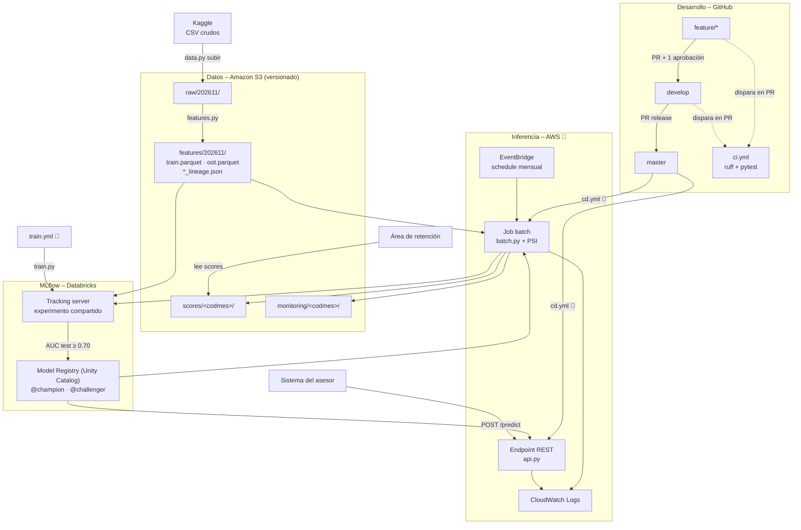

# Arquitectura

Este documento describe los componentes de la solución, cómo se conectan y qué los dispara.
Se distingue lo **implementado** (✅) de lo **en implementación** (🚧).

## 1. Vista general

## 2. Componentes

### 2.1 Control de versiones – GitHub ✅

- Repositorio en la organización `utec-curso-mlops-2026-2`, creado desde la plantilla del curso.
- **Gitflow**: `feature/*` → `develop` → `master`. Las dos ramas principales tienen *rulesets*:
  integración solo por PR, al menos 1 aprobación de otro integrante y CI en verde.
- `.gitignore` excluye datos (`*.csv`, `*.parquet`, `data/`), modelos (`*.pkl`, `*.joblib`,
  `mlruns/`), entornos virtuales y credenciales (`.env`, `.aws/`, `*.pem`).

### 2.2 Datos y versionamiento – Amazon S3 ✅

- Bucket con **versionado de objetos** y **bloqueo de acceso público**. Su nombre vive en
  `MLOPS_DATA_BUCKET`, nunca en el código.
- **Dos niveles de versión:**
  - *Entrega* (`raw/<yyyymm>/`): carpeta inmutable por fecha de corte.
  - *Objeto* (`VersionId` de S3 + SHA-256): registrados en `docs/manifiesto_datos.json`.
- `features.py` rechaza leer un archivo cuyo SHA-256 no coincide con el manifiesto y escribe un
  `<split>_lineage.json` (crudos → features) para dar trazabilidad.
- Entrenamiento y batch consumen **las mismas features** desde `features/202611/`.
- Detalle en [`contrato_datos.md`](contrato_datos.md).

### 2.3 Pipeline de entrenamiento ✅

Scripts modulares en `src/bank_attrition/`, parametrizados con `config/config.yaml`:

1. **Cruce y features** (`features.py`): clientes + requerimientos de los últimos 5 meses.
2. **Split** train/test 70/30 estratificado, semilla 42 (`train.py`).
3. **Limpieza e imputación** (`preprocess.py`): `ColumnTransformer` ajustado solo con train. Va
   dentro del `Pipeline` de scikit-learn, por lo que **se reutiliza idéntico en batch y online**.
4. **3 modelos**: Regresión Logística, Random Forest y LightGBM.
5. **Selección** explícita por `test_auc` (`train.selection_metric`).
6. **Scoreo del OOT** en el pipeline batch.

Métricas (`evaluate.py`): AUC, Gini, KS y % de fugas capturadas en el top 10 % y 20 %.

### 2.4 Tracking y Model Registry – MLflow en Databricks ✅

- **Tracking server remoto** compartido (`MLFLOW_TRACKING_URI=databricks`), experimento
  `/Shared/utec-bank-attrition`.
- Run padre `training_pipeline` con un **run anidado por modelo**; `mlflow.sklearn.autolog`
  registra los hiperparámetros.
- Artefactos: curva ROC, matriz de confusión, importancia de variables y linaje de datos.
- Tags: `git_commit`, `author`, `data_version`, `data_path`, `data_sha256`, `data_s3_version_id`.
- El mejor modelo se registra con **signature**, **input example** y su entorno.
- **Criterio de promoción** (`promote()` en `train.py`):
  - AUC test < 0.70 → versión marcada `validation=rejected`, sin alias.
  - AUC test ≥ 0.70 y mejor que el `champion` actual → alias `champion`.
  - AUC test ≥ 0.70 pero no mejor → alias `challenger`.
- Batch y API cargan **siempre** `models:/<modelo>@champion`, nunca un archivo local.

### 2.5 Inferencia batch – AWS 🚧

- **Implementado** (`batch.py`): carga `@champion`, scorea el OOT y escribe en
  `s3://<bucket>/scores/<codmes>/scores.csv` las columnas `id_cliente`, `prob_fuga`, `decil`
  (1 = mayor riesgo), `segmento_riesgo` (alto/medio/bajo), `codmes_score`, `fecha_score` y
  `model_version`. Registra un run `batch_<codmes>` en MLflow con el linaje.
- **En implementación**: ejecución en AWS programada mensualmente con **EventBridge** y logs en
  **CloudWatch**. `<completar servicio elegido y justificación>`.

### 2.6 Inferencia online – AWS 🚧

- **Implementado** (`api.py`): API FastAPI que carga el modelo una sola vez al arrancar.
  - `GET /health`: estado, nombre y versión del modelo.
  - `POST /predict`: recibe el cliente y sus requerimientos en JSON, construye las features con la
    **misma función** que el pipeline (`build_features`) y devuelve `prob_fuga` y `model_version`.
  - Validación: `422` si falta un campo o tiene un tipo incorrecto; `400` si no se puede scorear.
- **En implementación**: despliegue en AWS. `<completar: servicio elegido (Lambda + API Gateway,
  App Runner, ECS…), URL y justificación>`.

### 2.7 Monitoreo ✅ / 🚧

- **Data drift** ✅ (`monitoring.py`, como paso del batch): PSI por variable y sobre la distribución
  del score, train vs aplicación, con 10 bins. Semáforo: < 0.10 estable · 0.10–0.25 alerta ·
  > 0.25 crítico. El reporte se guarda en `s3://<bucket>/monitoring/<codmes>/psi_variables.csv` y en
  MLflow (`psi_score`, `n_vars_alerta`, `n_vars_critico`).
- **Model/concept drift** 🚧: plan propuesto en el informe técnico para cuando lleguen las
  etiquetas reales (6 meses después).

### 2.8 CI/CD – GitHub Actions

| Workflow | Disparador | Función | Estado |
|---|---|---|---|
| `ci.yml` | PR y push a `develop`/`master` | `ruff` + `pytest`; bloquea el PR si falla. Sube el reporte de pruebas como artefacto. | ✅ |
| `train.yml` | `workflow_dispatch` | Features + entrenamiento + registro en MLflow | 🚧 |
| `cd.yml` | Integración a `master` | Construir y desplegar batch y API en AWS | 🚧 |

Las credenciales (AWS, Databricks) se entregan solo mediante **GitHub Secrets**.

## 3. Disparadores

| Evento | Qué se ejecuta |
|---|---|
| Pull Request a `develop` o `master` | CI (lint + pruebas) |
| Ejecución manual de `train.yml` | Entrenamiento y registro del modelo |
| Merge a `master` | CD: despliegue de batch y API en AWS |
| Schedule mensual (EventBridge) | Inferencia batch + reporte de drift |
| Llamada del sistema del asesor | `POST /predict` en el endpoint online |

## 4. Flujo de un modelo de punta a punta

1. Data Engineering publica una nueva entrega → se sube a `raw/<yyyymm>/` y se actualiza el manifiesto.
2. Se generan las features con su linaje.
3. `train.yml` entrena los 3 modelos y registra el mejor en MLflow.
4. Si pasa la validación y supera al actual, recibe el alias `champion`.
5. El batch mensual y la API cargan automáticamente el nuevo `@champion`, sin cambiar código.
6. El batch calcula el PSI; si hay drift crítico, se revisa el modelo y se reentrena.
